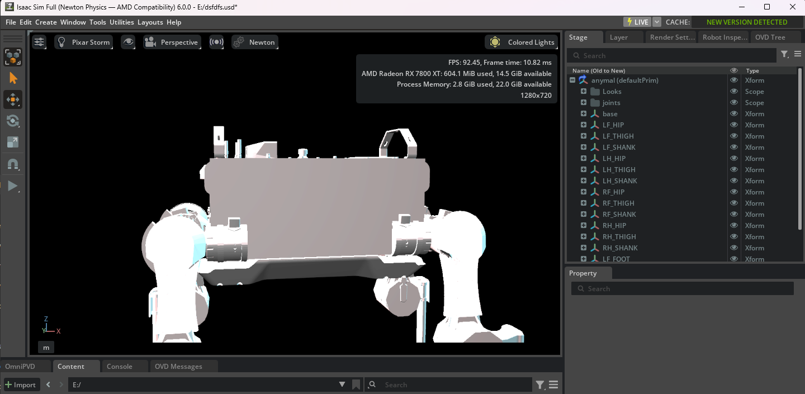
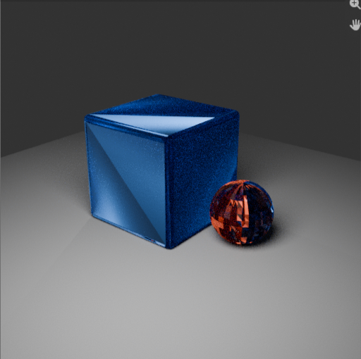
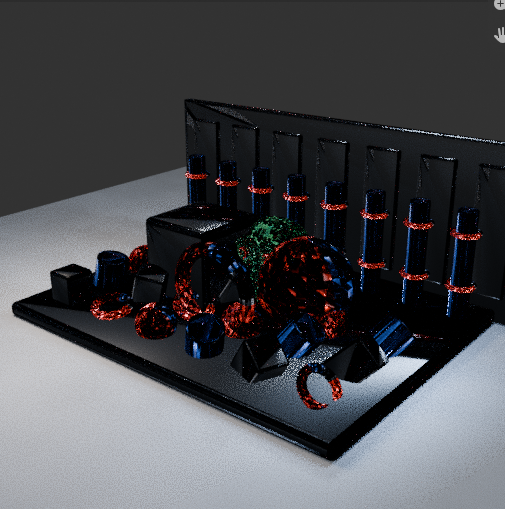
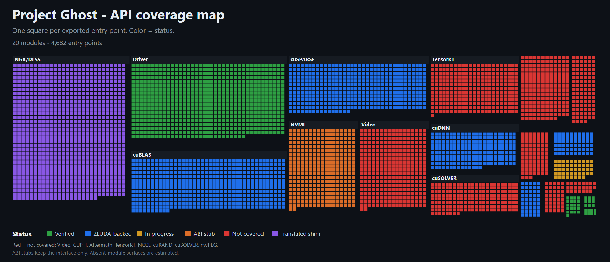

# Project Ghost

**Version 1.56 — Windows x64**

**Interoperability middleware for NVIDIA-first AI and rendering software on AMD
RDNA hardware — CUDA translated to HIP at runtime, backed by ZLUDA.**

**Windows 10/11 x64 only. There is no Linux or macOS build.**

[Join the Discord](https://discord.gg/HvUPDhJQns) ·
[Documentation](https://github.com/Void-Compute/Technical-Docs) ·
[Report an Issue](https://github.com/Void-Compute/AMD-Ghost-Environment/issues)

*Isaac Sim Full (Newton Physics), raster viewport, RX 7800 XT, ~92 FPS.*

---

## Overview

Project Ghost runs NVIDIA-first AI and rendering software on AMD RDNA hardware.
It combines ZLUDA's CUDA-to-HIP translation with generated compatibility stubs
and a managed Windows environment.

- **Windows 10/11 x64 only.** Registry, WMI, elevation and DLL deployment are
  Windows-specific; Linux is not a target.
- **ZLUDA** translates CUDA driver and runtime calls to HIP.
- **Generated stubs** satisfy NVIDIA driver and library checks.
- **Ghost** manages HIP overrides, Python hooks, deployment and the shell.

### Current Status

**Working**

- CUDA driver surface: initialization, device enumeration, contexts, memory,
  streams, events, module loading, JIT and kernel launch.
- NVIDIA **Warp 1.13** initializes and compiles kernels on RDNA hardware.
- **Blender 5.2.3 Cycles** renders with the OptiX device through Ghost's
  Vulkan ray-query backend.
- **NGX / DLSS** calls translate to AMD FSR/XeSS.
- **Isaac Sim** raster viewport runs at ~92 FPS on an RX 7800 XT.
- CUDA-Vulkan external-memory and semaphore interop.

**In progress**

- OptiX tile/film mapping. Renders are correct; residual pane artifacts remain
  on non-tile-aligned sample tails.
- Isaac Sim RTX/HIP-RT path, sensors and iray.
- Broader OptiX application coverage and stability.

---

## Blender OptiX Renders

Cycles, OptiX device, Blender 5.2.3 on an RX 7800 XT through Ghost.

| Test scene | Benchmark scene |
|:---:|:---:|
|  |  |
| Cube and sphere, 14.7 s | 32 spp benchmark render |

---

## API Coverage

*One square = one known export. Hollow squares are unverified surface, not
counts. Color = status. Red = no functional path; absent-library surfaces are
estimated.*

| API / library | Module(s) | Status |
|:--- |:--- |:--- |
| CUDA Driver (731), CUDA Runtime redirector, NVRTC (21) | ZLUDA + Ghost tee | **Verified** |
| cuBLAS (530), cuSPARSE (448), cuDNN 8/9 (221), cuFFT (60), cuBLASLt (45) | ZLUDA bundles | **ZLUDA-backed** |
| OptiX (48) | `nvoptix.dll` | **In progress** |
| CUDA-Vulkan interop (9), Vulkan layer (8) | Ghost DLLs | **Verified** |
| NGX / DLSS (945) | `nvngx.dll` | **Translated** to FSR/XeSS |
| NVML (342) | Ghost stub | **ABI stub** |
| Video (342), CUPTI (189), Aftermath (23) | Ghost stubs | **Not covered** (ABI only) |
| TensorRT, NCCL, cuRAND, cuSOLVER, nvJPEG | — | **Not bundled** |

OptiX ray tracing is the active work. Stubs keep the interface, not the feature.
This is a surface inventory, not a compatibility guarantee.

---

## Quick Start

> **Windows 10/11 x64 only.** You need an AMD RDNA or Vega GPU, Administrator
> rights, and [Visual Studio Build Tools (C++)](https://visualstudio.microsoft.com/visual-cpp-build-tools/).
> Ghost manages registry configuration and deploys system stubs during setup;
> `doctor` verifies the toolchain automatically.

1. Download the latest Windows build from the
   [Releases](https://github.com/Void-Compute/AMD-Ghost-Environment/releases) page,
   or build from source.
2. Right-click `ghost_amd.exe` and select **Run as Administrator**.
3. On first launch, Ghost downloads its dependencies (ZLUDA, HIP SDK components,
   compatibility stubs) and detects the installed hardware.

### The Ghost Shell

Once inside the `(ghost amd)>` prompt:

| Command | Description |
|---|---|
| `run [--no-tui] <script.py\|.bat\|.exe> [args]` | Runs Python scripts, batch files or Windows executables with failover and the Waiting Room interface |
| `translate <folder>` | Converts CUDA C++/Python source to AMD HIP via HIPIFY |
| `benchmark` | Measures GPU throughput (FP16 / FP32 TFLOPS) |
| `doctor` | Checks MSVC `cl.exe`, ROCm, drivers and the HIP SDK |
| `install-deps` | Re-downloads the core Ghost components |
| `clean-stubs` | Removes Ghost-deployed DLL/EXE stubs from the current folder tree; keeps `.ghost` and registry setup |
| `clean` | Removes Ghost registry configuration and purges `.ghost` |

### The Waiting Room

While large models load, Ghost shows live telemetry and keeps the shell usable:

- VRAM usage, temperature and GPU load
- **DOOM** (key: `D`)
- Toggleable background music (key: `M`)
- Control returns to the application as soon as it opens its local port

---

## Hardware Support

Ghost maps detected AMD hardware to the closest NVIDIA compatibility profile so
device checks and library heuristics select functional code paths.

| AMD Host Series | Mask Version | Compatibility Profile |
|:--- |:--- |:--- |
| RX 9000 Series | 12.0.0 | GeForce RTX 5090 class |
| RX 7000 Series | 11.0.0 | GeForce RTX 4090 class |
| RX 6000 Series | 10.3.0 | GeForce RTX 3090 Ti class |
| RX 5000 Series | 10.1.0 | GeForce RTX 2080 Ti class |
| Radeon VII / MI50 | 9.0.6 | Tesla V100 class |
| Vega 64 / Vega 56 | 9.0.0 | Tesla P100 class |

For unsupported devices, open an issue. New profiles are usually a single
mapping entry.

---

## Technical Architecture

- **Windows integration** — registry configuration, WMI queries, elevated DLL
  deployment and process launch. Windows 10/11 x64 only.
- **JIT stub generation** — compiles C++ with `cl.exe` at runtime to produce an
  `nvml.dll` abstraction reflecting the detected AMD VRAM and device name.
- **Smart failover** — launches natively through ROCm first; on crash or
  incompatibility, relaunches with the ZLUDA translation layer injected.
- **OptiX backend** — translates OptiX launches to Vulkan ray queries through
  CUDA-Vulkan interop, with no NVIDIA GPU in the path.
- **`HSA_OVERRIDE_GFX_VERSION`** — maps unsupported RDNA revisions onto
  compatible ROCm targets.
- **Python import hooks** — `sitecustomize.py` makes `torch.cuda.is_available()`
  report correctly for stacks that probe before initialization.
- **Registry guard** — scopes configuration under
  `SOFTWARE\NVIDIA Corporation`; `clean` removes everything Ghost created.

Architecture analysis, design notes and reverse-engineering history live in
**[Void-Compute/Technical-Docs](https://github.com/Void-Compute/Technical-Docs)**.

---

## Roadmap

| Status | Item |
|:---|:---|
| Completed | Windows shell and daemon (registry, WMI, deployment) |
| Completed | ZLUDA integration with ROCm-first failover |
| Completed | CUDA driver/runtime surface, NVRTC and runtime JIT |
| Completed | CUDA-Vulkan external-memory and semaphore bridge |
| Completed | First working OptiX device path in Blender Cycles |
| Completed | NGX/DLSS to FSR/XeSS translation |
| Completed | Isaac Sim raster viewport |
| In progress | OptiX tile/film mapping and artifact-free output |
| In progress | Isaac Sim RTX/HIP-RT, sensors and iray |
| Next | OptiX application coverage and stability |
| Next | Hardware matrix expansion and community beta |
| Not planned | Linux and macOS builds |

Development runs alongside full-time studies; stability comes before release
speed.

---

## Community

- **[Discord](https://discord.gg/HvUPDhJQns)** — updates, support and the
  community hardware-testing program
- **[Issues](https://github.com/Void-Compute/AMD-Ghost-Environment/issues)** —
  include GPU model, driver version and `ghost_trace.log`
- **[Technical-Docs](https://github.com/Void-Compute/Technical-Docs)** — full
  history, architecture analysis and planned work

## FAQ

**Does it run on Linux?**

No. Ghost targets Windows 10/11 x64. Registry, WMI, elevation and DLL deployment
are core to how it works; Linux and macOS are not planned.

**Does Isaac Sim run on AMD yet?**

The raster viewport works. RTX/HIP-RT, sensors and iray are the active research
targets. CUDA compute through Isaac Sim frameworks such as Warp already runs on
RDNA via Ghost.

**Does Blender OptiX work?**

Yes. Cycles renders with the OptiX device through Ghost's Vulkan ray-query
backend. Tile/film mapping is still being finished, so some sample counts show
pane artifacts.

**Why are Administrator rights required?**

Ghost configures the registry and deploys system-level stubs during setup. All
changes are reversible with `clean`.

**Where did my registry changes go?**

`clean` removes Ghost-managed keys and purges `.ghost`. Ghost does not modify
keys it did not create.

---

## Legal Notice and Trademarks

This is an independent research project. It is **not affiliated with, endorsed by, or
sponsored by NVIDIA Corporation or Advanced Micro Devices, Inc.**

CUDA, NVIDIA, GeForce and Tesla are trademarks of NVIDIA Corporation. ROCm, HIP and
Radeon are trademarks of Advanced Micro Devices, Inc. All other names may be trademarks
of their respective owners. Trademark references describe compatibility relationships
only and imply no endorsement.

This software is provided under the **GNU Affero General Public License v3.0**, without
warranty of any kind. Ghost modifies system configuration (reversible via `clean`);
users are responsible for creating appropriate system backups before use.

---

*Developed to extend the usable capability and lifetime of AMD hardware.*

